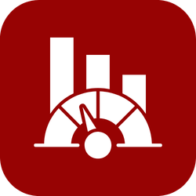
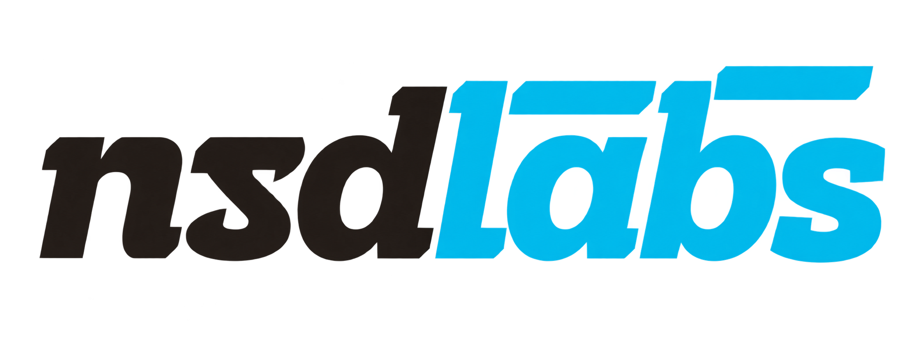

<div align="center">
	
	<h2>Kayan KPI</h2>
	<p align="center">
		<p>KPI scorecards for Application and Sales Engineers, built on ERPNext and Frappe HR</p>
	</p>


</div>

## Kayan KPI

Kayan KPI measures Application Engineers and Sales Engineers against their quarterly goals,
straight from the quotations, orders, opportunities and payments already recorded in ERPNext.
Every score can be traced back to the documents behind it, so a performance review rests on
records rather than recollection.

It installs alongside ERPNext and Frappe HR on Frappe v16 (16.51 and later) and changes
nothing in either app: everything is added through custom fields, document events and its own
DocTypes.

### Motivation

Kayan's KPI frameworks for Q3 and Q4 set seven goals for each engineering role, each with a
target, a weight and a rule for how it is checked. Most of those checks already happen in
ERPNext (a quotation is submitted, an order is paid, a customer orders again); the rest
(technical reviews, competitor studies, client ratings) only need a structured place to record
them. Kayan KPI connects the two and does the arithmetic the same way for everyone.

### Key Features

- **Two ready-made templates.** *Application Engineer KPIs* and *Sales Engineer KPIs* are
  created on install with the goals, targets, weights and checks from Kayan's documents.
  Targets and weights stay editable.
- **Automatic KPIs from ERPNext.** Quote turnaround against a 3 working-day SLA, quotation win
  rate, complete paperwork, sales target, hit rate on paid orders in hand, new clients, sales
  cycle time, repeat-client revenue and record timeliness are calculated from live data.
- **Structured manager checks.** Technical Reviews (selection accuracy and standards),
  Technical Queries (reply time and client rating) and Competitor Studies (checklist and rating)
  feed the remaining KPIs. A weekly random sample of quotations is assigned to KPI Managers for
  review.
- **Scorecards with approval.** One scorecard per engineer per quarter, recalculated nightly
  while in draft, approved (submitted) by a KPI Manager and then locked. A manager can enter or
  override an actual only with a written reason.
- **Evidence for every number.** The *KPI Evidence* report lists each document counted for a
  KPI, the credit the engineer received and the result.
- **Data Quality Audit.** Lists the records that would make a KPI wrong (quotations with no
  engineer, orders with no sales team, sales persons not linked to an employee, stale deals)
  so they can be fixed before scorecards are approved.
- **Margin bonus.** Deals above the margin threshold earn bonus points, kept outside the 100%.
- **Both CRMs.** Works with ERPNext's own Lead and Opportunity, or with the Frappe CRM app.
- **Frappe HR.** Each employee carries a KPI Template; approved scores can be written to HRMS
  Goals in the quarter's Appraisal Cycle.

### Under the Hood

- [**Frappe Framework**](https://github.com/frappe/frappe): the full-stack framework the app is built on.
- [**ERPNext**](https://github.com/frappe/erpnext): quotations, orders, invoices, payments, opportunities and sales persons.
- [**Frappe HR**](https://github.com/frappe/hrms): employees, the reports-to tree, KRAs, appraisal cycles and goals.
- [**Frappe CRM**](https://github.com/frappe/crm) (optional): deals and leads when it is the CRM in use.

## Production Setup

```bash
bench get-app <repository-url>
bench --site <site> install-app kayan_kpi
bench --site <site> migrate
bench build --app kayan_kpi
bench restart
```

Installing creates the roles, custom fields, both KPI templates and the *Q3 2026* and *Q4 2026*
periods, then fills the KPI fields on quotations submitted before the install (in the
background). Every step is safe to repeat and runs again on each migrate, except the templates
and periods, which are created once.

Requires Frappe, ERPNext and Frappe HR version 16, and Python 3.14.

### First-time configuration

1. **Kayan KPI Settings.** Choose the CRM source, sales basis (Sales Order or Sales Invoice),
   sales target source, when an order counts as in hand, the quotation credit rule, whether
   achievement may exceed 100% (and the cap), and the margin bonus formula.
2. **Holiday List.** Set one in the settings, or on the Company. Weekends and holidays are
   left out of the 3 working-day SLA.
3. **Employees.** Link each engineer's **User ID**, and set **KPI Template** (in the company
   details of the Employee form). Set **Reports To** so managers see their team.
4. **Sales Persons.** Link every Sales Person to its Employee. Orders are credited to Sales
   Engineers through the Sales Team table.
5. **Roles.** Give engineers *Application Engineer* or *Sales Engineer*, and managers *KPI Manager*.
6. **Sales targets.** Either the Targets table on each Sales Person, or the Sales Targets table
   on the KPI Period, according to the setting.
7. **Scorecards.** Open a KPI Period and click **Create Scorecards**.

### Day-to-day use

| Who | Where | What |
|---|---|---|
| Application Engineer | Quotation → **KPI** tab | Request time, inquiry size, engineers, datasheet and calculation attachments |
| Application Engineer | Technical Query | Client questions; the first email sent from it counts as the reply |
| Sales Engineer | Opportunity → **KPI Tracking** | *Change Happened On* when the sales stage changes |
| Sales Engineer | Sales Order | Customer PO number and date; Sales Team |
| Either engineer | Competitor Study | One per project, created from the quotation |
| KPI Manager | Technical Review | Selection and standards check per quotation |
| KPI Manager | Competitor Study | Checklist and rating, then submit |
| KPI Manager | KPI Scorecard | Check the Data Quality Audit, recalculate, approve |

## How each KPI is measured

| KPI | Measured as | From |
|---|---|---|
| Quote turnaround | % of quotations ready (submitted) by their due time | Request time on the Opportunity, CRM Deal or Quotation; due = +3 working days, or the date agreed with the manager for complex inquiries |
| Selection accuracy | % of reviewed selections passed with no correction | Latest submitted Technical Review per quotation; by default only quotations that became orders |
| Standards compliance | % of reviewed selections compliant | Same Technical Reviews |
| Client query service | Half reply-within-24h rate, half average rating against 4.5 | Technical Queries |
| Quotation win rate | % of quotations issued that were ordered | Quotation status |
| Paperwork complete | % of quotations with datasheet and calculation; drafts older than 7 days count as incomplete | Quotation documents table |
| Sales target | Sales ÷ target | Sales Orders or Sales Invoices, net of tax, by Sales Team allocation |
| Hit rate | Paid orders in hand ÷ quotations issued | In hand = customer PO received and/or advance paid (setting) |
| New clients | Customers whose first order falls in the quarter | Sales Orders or Sales Invoices |
| Sales cycle | % of orders signed within 60 days of first contact | Lead / CRM Lead → Quotation → Sales Order |
| Repeat clients | % of revenue from customers who ordered before the quarter | Sales Orders or Sales Invoices |
| Records up to date | % of changes recorded within 48 hours | Opportunity stage and decision changes, CRM Deal status changes, and order entry after the customer PO date |
| Competitor study | Average study score; a quotation without a study scores 0 | Competitor Study checklist (incl. on time) and manager rating |

Credit for a quotation or order handled by several engineers follows the **Quotation Credit
Rule**: primary engineer only, split equally (orders use the Sales Team %), or full credit to
each. When a KPI has no data in the quarter, it is left out and the other weights are scaled
up, or scored 0 or 100%, according to **When a KPI Has No Data**.

## Development Setup

```bash
bench get-app <repository-url>
bench new-site kayan.localhost --install-app erpnext --install-app hrms
bench --site kayan.localhost install-app kayan_kpi
bench --site kayan.localhost set-config developer_mode 1
bench start
```

Tests:

```bash
bench --site kayan.localhost run-tests --app kayan_kpi
# the scoring and working-day rules also run without a site:
python -m unittest kayan_kpi.tests.test_scoring
```

## Repository Layout

```
kayan_kpi/
├── hooks.py                     events, permissions, scheduler, desk icons
├── constants/custom_fields.py   fields added to Quotation, Opportunity, Employee, items, CRM Deal
├── kpi/
│   ├── scoring.py               achievement, weights, margin and bonus rules (pure Python)
│   ├── working_days.py          SLA date arithmetic (pure Python)
│   ├── sources.py               request time from ERPNext CRM or Frappe CRM; in-hand orders
│   ├── engine.py                builds and scores KPI Scorecards
│   └── metrics/                 one function per KPI
├── events/                      Quotation, Opportunity / CRM Deal, Communication
├── kayan_kpi/doctype/           14 DocTypes
├── kayan_kpi/report/            5 script reports
├── workspace_sidebar/, kayan_kpi/sidebar/, dock/, desktop_icon/   v16 desk
└── public/icons/kayan-kpi-icons.svg                              sidebar and dock icons
```

## Support

nsdLabs, Nest Software Development: [info@nsd-eg.com](mailto:info@nsd-eg.com)

<br>
<br>
<div align="center" style="padding-top: 0.75rem;">
	<a href="mailto:info@nsd-eg.com">
		<picture>
			<source media="(prefers-color-scheme: dark)" srcset=".github/nsdlabs-white.png">
			
		</picture>
	</a>
</div>
